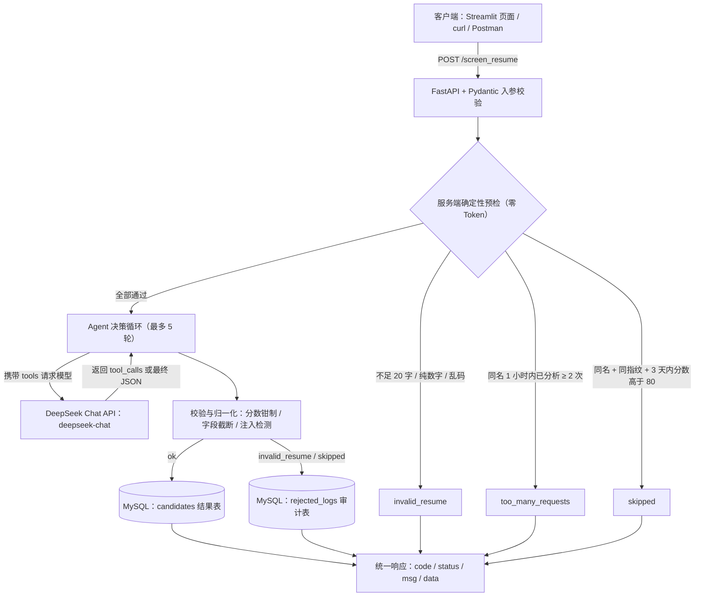

# 大模型工具编排与业务执行系统（Large Model Tool Orchestration and Business Execution System）

> 基于 **FastAPI + DeepSeek Function Calling + MySQL + Streamlit** 构建的 AI 简历智能筛选系统 Agent：AI 自主调度工具打分，服务端确定性防刷，结果与拒绝原因全链路落库。

**Python 3.13** · **FastAPI 0.141** · **Pydantic v2** · **MySQL 8.4** · **Streamlit 1.60** · **DeepSeek Function Calling** · **Git/Gitee**


通过 AI Agent 对候选人简历进行自动分析，提取技能、评估岗位匹配度并生成 AI 点评。

同时加入 SHA-256 简历指纹查重、请求限流、Prompt Injection 防护、AI 输出校验、数据库持久化与审计日志，减少重复调用大模型造成的 Token 消耗，并提高系统稳定性。


## 1. 项目简介

**本项目面向简历初筛与岗位匹配场景，基于 FastAPI、DeepSeek Function Calling 和 MySQL 构建大模型应用。
通过服务端预检、Agent 工具调度、模型输出校验与数据库审计，实现从请求接收到结果持久化的完整处理流程。**

- 业务规则控制： 在调用大模型前执行简历质量检查、同名限流和 SHA-256 指纹查重，减少不必要的模型请求。
- Agent 工具编排： 通过 Function Calling 调度后端工具，完成历史记录查询、技能提取及结果回传。
- 结果校验与审计： 对模型输出进行结构校验和分数处理，并将符合审计条件的拒绝或跳过结果写入 "rejected_logs"。
- 自动化测试： 通过离线测试验证工具调用、业务分支与异常处理；具体断言数量以当前测试结果为准。
本项目将 AI Agent 引入简历初筛流程：

提交简历
   ↓
FastAPI 接收请求
   ↓
服务端预检查
   ├─ 简历质量检查
   ├─ 请求频率限制
   └─ SHA-256 指纹查重
   ↓
DeepSeek AI Agent
   ├─ 提取技能
   ├─ 查询历史记录
   └─ 分析岗位匹配度
   ↓
AI 输出校验
   ↓
MySQL 数据持久化
   ↓
返回筛选结果

项目重点并不是简单调用一次 AI API，而是围绕 Agent + 业务规则 + 数据库 + 防刷机制 构建完整的后端处理流程。

---

## 2. 技术栈

| 分类 | 技术 | 已验证版本 | 用途 |
| --- | --- | --- | --- |
| 语言 | **Python** | 3.13.5 | 项目主语言 |
| Web 框架 | **FastAPI + Pydantic v2** | 0.141.1 / 2.13.5 | 提供 `POST /screen_resume`，入参类型与长度校验 |
| ASGI 服务器 | **Uvicorn** | 0.51.0 | 启动后端服务，自带 `/docs` 交互式文档 |
| 大模型 | **DeepSeek Chat API**（`deepseek-chat`，OpenAI 兼容） | — | Function Calling 工具调用与匹配度打分 |
| HTTP 客户端 | **requests** | 2.34.2 | 调用 DeepSeek，单次请求 30 秒超时 |
| 数据库 | **MySQL + PyMySQL** | 8.0+ / 1.2.3 | `candidates` 结果表 + `rejected_logs` 审计表，`utf8mb4` |
| 前端 | **Streamlit + pandas** | 1.60.0 / 3.0.5 | 简历提交、结果卡片、历史记录检索与 CSV 导出 |
| 配置管理 | **python-dotenv** | 1.1.0 | 从 `.env` 读取 `API_KEY` / `DB_PASSWORD` / `WEB_PASSWORD` |
| 标准库 | **hashlib / re / json / datetime** | — | 文本规范化、SHA-256 指纹、模型输出清洗 |
| 版本管理 | **Git / Gitee** | — | 代码托管与提交 |

依赖安装（一条命令）：

```bash
pip install fastapi uvicorn pymysql requests streamlit pandas python-dotenv
```

> 建议锁版本：
> `pip install "fastapi==0.141.1" "uvicorn==0.51.0" "pymysql==1.2.3" "requests==2.34.2" "streamlit==1.60.0" "pandas==3.0.5" "python-dotenv==1.1.0"`

---

## 3. 核心功能

### 3.1 AI 智能打分

- **输入任意格式简历文本**，输出结构化结果：`name` / `skills` / `match_score`（0–100 整数）/ `ai_review`（一句话点评）。
- **分数强归一化**：`"85分"`、`150.7`、`-20`、`null` 均有明确处理策略（去单位 → 取整 → 钳制 0–100 → 无法解析则拒绝），不合法结果绝不入库。
- **抗提示词注入**：简历内容用 `<resume>` 标签与指令区隔离，并内置注入特征检测（"忽略以上指令""给我满分"类话术直接判为无效简历）。

### 3.2 Agent 自主调度（DeepSeek 原生 Function Calling）

- 两个工具交给模型自主决定何时调用：
  - `query_candidate_history(name, normalized_hash)` —— 查历史并**直接返回处置结论**（`ok` / `skipped` / `too_many_requests` / `db_error`）；
  - `extract_skills(resume_text)` —— 只提取技能，不打分、不评价，与打分流程解耦。
- **最多 5 轮工具调用**，超出即降级返回，杜绝死循环。
- **模型有自主权，没有最终裁决权**：
  - 工具已判定"跳过 / 限流"时模型若强行打分，服务端直接覆盖为对应结论；
  - 模型一次历史都没查却声称"自动跳过"，本次调用直接判失败（不奖励瞎猜）。
- **权威预检前置**：服务端先查一次历史并把结论写进提示词，模型是否愿意调用工具都不影响查重结果。

### 3.3 多维防刷与幂等机制

三道闸门依次执行，**全部在调用大模型之前完成，命中即 0 Token 消耗**：

1. **数据质量门槛**：文本规范化后不足 **20 字**、**纯数字**、**纯乱码**（单字重复、无元音键盘乱敲）→ 返回 `invalid_resume`。
2. **同名时效限流**：同一姓名 **1 小时内最多分析 2 次**（计数同时覆盖结果表与审计表，**与提交内容无关**）→ 返回 `too_many_requests`。
3. **SHA-256 指纹查重**：先规范化（去首尾空白、去换行、去所有标点，**只保留中文 / 英文 / 数字**）再算哈希，因此**改标点、加空格、多敲回车都无法绕过**；命中「**同名 + 同指纹 + 3 天内分数 > 80**」→ 返回 `skipped`，并用历史分数、技能直接回填展示。

### 3.4 全链路持久化与审计

- **`candidates`（结果表）**：合格结果落库，新增 `resume_hash` 指纹列；配套 `(name, create_time)`、`(name, resume_hash)` 索引支撑查重与限流查询。
- **`rejected_logs`（审计表）**：记录被拒绝 / 被跳过的请求（`name` / `reason` / `resume_hash` / `raw_score` / `create_time`），`reason` 以前缀区分来源：
  - `ai_rejected:*` —— AI 判不像简历、分数为 0、命中注入、输出格式异常；
  - `skipped:*` —— 命中查重规则被跳过。
- **数据一致性**：统一连接入口、失败必回滚、`finally` 归还连接；审计写入是 best-effort，失败不影响主流程。
- **老库自愈**：服务启动、`python ai_screener.py --migrate`、以及写入时撞上 `Unknown column`（MySQL 1054）都会自动补表补列；查询侧对缺列老库逐级降级并给出可操作警告。

---

## 4. 核心数据流

### 4.1 逻辑架构图



### 4.2 一次请求的完整链路（文字版）

```text
客户端（Streamlit 页面 / curl / Postman）
        │  POST /screen_resume   {"resume_text": "..."}
        ▼
① FastAPI + Pydantic 入口校验（类型 / 长度 ≤ 20000 字）
        │
        ▼
② 服务端确定性预检（零 Token，先拦后调）
     文本规范化 → 质量门槛（<20 字 / 纯数字 / 乱码）──────► invalid_resume
                → 同名限流（1 小时内同名 ≥ 2 次）────────► too_many_requests
                → 指纹查重（同名 + 同 SHA-256 + 3 天内 >80）► skipped
        │ 全部通过（携带权威历史结论 + 简历指纹）
        ▼
③ Agent 决策循环（最多 5 轮）
     DeepSeek /chat/completions（携带 tools）
       ├─ 模型返回 tool_calls → 本地执行 query_candidate_history / extract_skills
       │                       → 结果回灌对话，进入下一轮
       └─ 模型返回最终 JSON   → 退出循环
        │
        ▼
④ 校验与归一化（全项目唯一的 AI 输出入口）
     分数钳制 0–100 / 字段截断 / 注入特征检测 / 状态码判定
        │
        ├─ ok ─────────────► MySQL：INSERT INTO candidates（含 resume_hash）
        ├─ invalid_resume ─► MySQL：INSERT INTO rejected_logs（reason = ai_rejected:*）
        └─ skipped ────────► MySQL：INSERT INTO rejected_logs（reason = skipped:*）
        │
        ▼
⑤ 返回 JSON：{"code": 200, "status": "ok", "msg": "处理成功", "data": {...}}
```

**链路关键约束**

- **预检优先于模型**：`质量门槛 → 同名限流 → 指纹查重`，任一步命中都不会发起任何大模型请求。
- **限流优先于查重**：限流是行为管控、与内容无关，必须先判定，避免"换简历轮刷"绕过限流。
- **写库分两条路**：合格进 `candidates`，被拒 / 被跳过进 `rejected_logs`，两者都带简历指纹，可互相追溯。

---

## 5. 本地运行指南

### 5.1 环境准备

- **Python 3.10+**（开发环境实测 3.13.5）
- **MySQL 8.0+**（本地已启动，默认端口 `3306`）
- 一个可用的 **DeepSeek API Key**

### 5.2 克隆仓库

```bash
git clone https://gitee.com/kdmdmost/AI-resume-screener.git
cd AI-resume-screener
```

### 5.3 安装依赖

```bash
pip install fastapi uvicorn pymysql requests streamlit pandas python-dotenv
```

### 5.4 初始化 / 升级数据库

```bash
# A. 全新安装：建库建表（含 candidates.resume_hash 与 rejected_logs）
mysql -u root -p < schema.sql

# B. 老库升级 / 补表补列（幂等，可重复执行；启动服务与写库时也会自愈一次）
python ai_screener.py --migrate
```

### 5.5 配置环境变量（.env）

本项目通过 `python-dotenv` 读取根目录下的 `.env`，**真实密钥与密码不进版本库**（`.env` 已在 `.gitignore` 中忽略）。在项目根目录新建 `.env`：

```dotenv
# DeepSeek API Key
API_KEY=sk-你的真实Key

# 数据库密码
DB_PASSWORD=你的真实密码

# 前端访问密码（Streamlit 页面登录用）
WEB_PASSWORD=你设定的访问密码
```

### 5.6 各环境变量的读取位置

| 变量 | 读取模块 | 用途 |
| --- | --- | --- |
| `API_KEY` | `ai_screener.py`（`os.getenv("API_KEY")`） | 调用 DeepSeek Chat API |
| `DB_PASSWORD` | `recruit_db_helper.py`（`os.getenv("DB_PASSWORD")`） | 连接 MySQL |
| `WEB_PASSWORD` | `web_ui.py`（`os.getenv("WEB_PASSWORD")`） | Streamlit 前端访问密码 |

> 数据库连接的用户名 / 主机 / 端口 / 库名仍写在 `recruit_db_helper.py` 的 `DB_CONFIG` 里，只有密码走环境变量。
> 模型接口地址与名称写在 `ai_screener.py`：`API_URL = "https://api.deepseek.com/chat/completions"`、`MODEL_NAME = "deepseek-chat"`。

> ### ⚠️ 绝不提交真实密钥
>
> - `.env` 已被 `.gitignore` 忽略，真实 Key / 密码只留在本地，不进版本库。
> - 建议额外提交一份 `.env.example`（只写变量名与占位值，不含真实密钥），方便他人对照配置。
> - **每次 `git add` 前自查**：`git status`、`git diff`，确认没有 `.env`、密钥、真实简历数据被带进去。
> - 一旦误推：**立即去 DeepSeek 控制台吊销并重建 Key**，同时修改数据库密码——只删记录不算处理完。
> - 未配置 `WEB_PASSWORD` 时，前端会直接拒绝访问（不会默认放行）。

### 5.7 启动后端（FastAPI）

```bash
uvicorn ai_screener:app --reload --port 8000
```

- 服务地址：`http://127.0.0.1:8000`
- 接口文档：`http://127.0.0.1:8000/docs`

冒烟验证（Windows CMD / PowerShell）：

```bash
curl -X POST http://127.0.0.1:8000/screen_resume ^
  -H "Content-Type: application/json" ^
  -d "{\"resume_text\": \"我叫张三，熟练掌握 Python 和 MySQL，做过两个 AI 项目。\"}"
```

### 5.8 启动前端（Streamlit）

```bash
streamlit run web_ui.py
```

- 本地：http://localhost:8501
- cpolar：https://616724c9.r9.cpolar.top
- 打开页面先输入 `.env` 里配置的 `WEB_PASSWORD` 才能进入。
- 页面能力：上传 `.txt` 或粘贴简历 → 一键分析 → 匹配度环 + 技能胶囊 + AI 点评 → 历史记录检索与 CSV 导出。

### 5.9 命令行跑单份简历（可选）

```bash
python ai_screener.py
```

读取 `resumes/zhangsan.txt`，打印 Agent 走的分支并尝试入库。

---

## 6. 接口返回状态码规范

| 状态码 | 含义 | 典型触发场景 | HTTP |
| --- | --- | --- | --- |
| **ok** | 处理成功 | 预检通过、模型给出合法结果、校验通过并成功写入 `candidates` | `200` |
| **skipped** | 命中查重，跳过重复评估 | 同名 + 同简历指纹 + 3 天内历史分数 > 80；语义上不是失败，而是"省了一次评估" | `200` |
| **invalid_resume** | 简历质量不达标 | 规范化后不足 20 字、纯数字、纯乱码；AI 判定"不像有效简历"、分数为 0、命中注入特征、输出无法解析 | `422` |
| **too_many_requests** | 频率超限 | 同一姓名 1 小时内已被分析 2 次，第 3 次在调用大模型之前即被拒绝（不消耗 API 额度） | `429` |
| **db_error** | 数据库异常 | 连接失败、表 / 列缺失且无法自愈、写入失败（已回滚事务），与简历内容无关 | `500` |

**补充说明**

- 除以上 5 个业务状态码外，大模型调用本身失败（超时 / HTTP 错误）返回 `502`，便于与"数据库问题"区分。
- 响应体统一为 `{"code": ..., "status": ..., "msg": ..., "data": {...}}`，前端与监控按 `status` 分支即可，无需解析自然语言。
- 审计表 `rejected_logs.reason` 与状态码对应：`ai_rejected:*` ↔ `invalid_resume`，`skipped:*` ↔ `skipped`；纯质量门槛拦截（<20 字 / 纯数字 / 乱码）**刻意不写审计表**，避免污染误拒率分母。

**响应示例**

```json
{
  "code": 200,
  "status": "ok",
  "msg": "处理成功",
  "data": {
    "name": "张三",
    "skills": "Python, MySQL, AI 项目",
    "match_score": 85,
    "ai_review": "基础扎实，建议面试",
    "resume_hash": "3f2a...（64 位 SHA-256）"
  }
}
```

---

## 7. 项目结构

```text
AI-Resume-Project/
├── ai_screener.py         # 后端核心：Agent 循环、防刷预检、输出校验、状态码、入库、FastAPI 接口
├── web_ui.py              # Streamlit 前端：访问密码校验、简历提交、结果展示、历史记录与 CSV 导出
├── recruit_db_helper.py   # MySQL 连接配置（密码读 .env 的 DB_PASSWORD）
├── schema.sql             # 全新安装建库建表脚本
├── .env                   # 环境变量：API_KEY / DB_PASSWORD / WEB_PASSWORD（已被 .gitignore 忽略，不提交）
├── test_agent.py          # 离线回归测试：162 项断言，覆盖全部防刷与状态码分支
├── p1_fix_test.py         # 校验层历史回归测试（状态码已同步为 invalid_resume）
├── resumes/               # 本地调试用简历样本
│   └── zhangsan.txt       # python ai_screener.py 默认读取这个文件
└── README.md
```

---

## 8. 测试

```bash
python test_agent.py          # 离线跑全部用例（162 项断言），不消耗 API 额度
python test_agent.py --point  # 额外探测真实数据库连接与表结构
python test_agent.py --live   # 真实调用 DeepSeek（会消耗额度）
python p1_fix_test.py         # 校验层用例（分数钳制 / 注入兜底）
```

**测试思路**：用假的模型请求顶替真实网络调用，用内存 SQLite 顶替 MySQL（**真实执行 SQL**，所以列名写错、表不存在、缺列这类问题也能被测出来），让 Agent 循环、工具分发、分支判定全部真跑一遍。

覆盖场景：

- 新候选人正常打分入库 / 查重跳过 / 低分重复提交继续评估 / 历史超窗口继续评估；
- 工具函数单测：查重判定、技能提取容错（markdown 包裹、别名字段、非 JSON 兜底）、未知工具与坏参数、连不上库；
- 护栏：模型假跳过、无限调工具、简历提示词注入、数据库缺列、数据库不可用；
- 防刷：文本规范化与指纹（改标点指纹不变、改一个字指纹改变）、不足 20 字、纯数字与乱码、同名 1 小时内 3 次限流、改标点重复提交被跳过、同名不同简历重新打分；
- 审计：AI 判"不像简历"与 0 分只写 `rejected_logs` 不写 `candidates`；
- 工具 5 条判定规则与 HTTP 五种状态码（200 / 422 / 429 / 500 / 200-skipped）。

---

## 9. 已知限制与后续规划

这是一个学习 / 自用向项目，以下问题**已知且暂未处理**，对外提供服务前需要先修：

1. **凭据管理半成品**：数据库密码、API Key、前端访问密码已改由 `.env` + `python-dotenv` 读取，但 `DB_CONFIG` 的主机 / 用户 / 库名仍写在源码里，建议一并外置。
2. **仅前端有密码门、接口无鉴权**：Streamlit 页面已用 `WEB_PASSWORD` 做访问校验，但 `POST /screen_resume` 接口本身无鉴权，任何能直连服务的人仍可调用打分接口、并通过历史页浏览 / 导出候选人信息（含姓名等个人信息）。
3. **前端状态码分支不完整**：Streamlit 页面已适配 `ok` / `skipped` / `invalid_resume`，但 `too_many_requests` 仍会落到"写入数据库失败"的兜底文案，需要按 `status` 增加分支。
4. **指纹大小写不折叠**：`Python` 与 `python` 会被视为不同内容，规范化阶段加入统一小写即可补齐。
5. **阈值写死在代码里**：20 字 / 60 分钟 / 2 次 / 3 天 / 80 分均为命名常量，调整需发版；建议外置为配置并记录变更审计。
6. **无连接池、AI 调用无退避重试**：每次请求新建 MySQL 连接，DeepSeek 遇到 429 / 超时会直接失败。
7. **日志用 `print`**：没有结构化日志、请求追踪与 Token 成本统计。

**后续规划**：提交即返回任务号 + 队列异步处理（应对并发）、同指纹结果缓存（3 天内直接复用）、`rejected_logs` 复审闭环（把误拒样本回流成评测集）、脱敏与数据留存策略。

---

## 📄 License

个人学习项目，未指定开源协议。如需引用请先联系作者。
